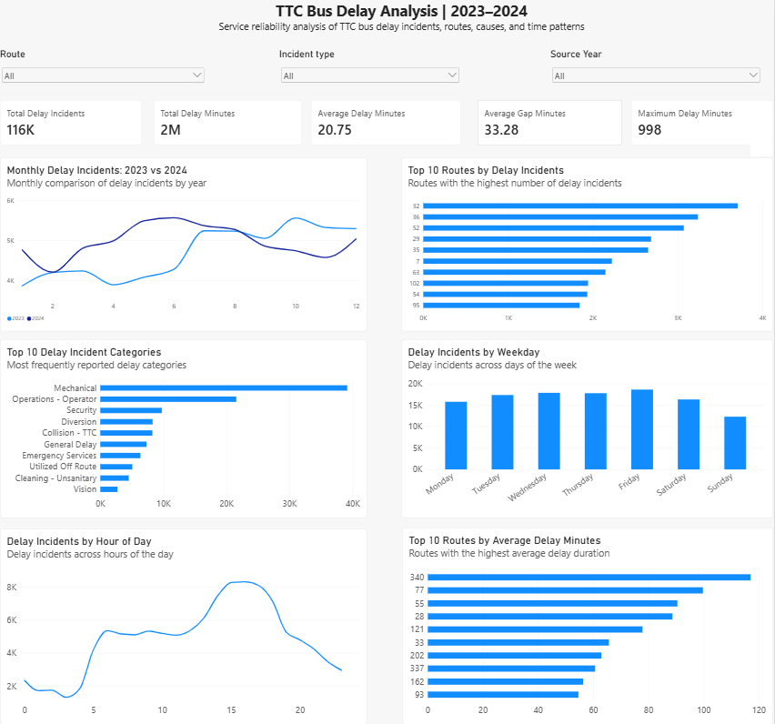

# TTC Bus Delay Analysis | 2023–2024

An end-to-end data analytics project examining TTC bus delay records from 2023 and 2024 to identify patterns in delay frequency, duration, routes, incident categories, and time of day.

The project combines Python and pandas for data preparation, PostgreSQL for validation and exploratory analysis, and Power BI for interactive visualization.

## Dashboard



The Power BI dashboard provides an interactive view of TTC bus delay patterns with filters for route, incident type, and source year.

### Dashboard KPIs

- Total delay incidents
- Total recorded delay minutes
- Average delay minutes
- Average gap minutes
- Maximum delay minutes

The dashboard also examines:

- Monthly delay incidents in 2023 vs. 2024
- Routes with the highest number of delay incidents
- Most frequently reported incident categories
- Delay incidents by weekday
- Delay incidents by hour of day
- Routes with the highest average delay duration

## Key Findings

- Recorded delay minutes increased from **1,138,282 in 2023 to 1,265,531 in 2024**.
- Average positive delay increased from **22.1 minutes in 2023 to 23.9 minutes in 2024**.
- March 2024 recorded **135,702 delay minutes**, compared with **91,931 in March 2023**. The median positive delay remained 12 minutes, while records of at least 120 minutes increased from 96 to 162.
- Diversion records accounted for **405,541 recorded delay minutes in 2023** and **531,557 in 2024**.
- The share of General Delay records containing zero-minute delays increased substantially between the two years, showing why category record counts alone can be misleading.
- Records logged at 7 AM in 2024 contained unusually high summed delay minutes, with Diversion records accounting for **70,138 of 107,518 minutes** assigned to that hour.

## Data Preparation

The raw TTC Excel datasets for 2023 and 2024 are processed with Python and pandas.

The preparation workflow:

1. Loads the yearly Excel datasets.
2. Combines 2023 and 2024 records into one dataset.
3. Standardizes column names and text fields.
4. Parses and validates date and time fields.
5. Creates analysis fields including month, hour, weekday, and source year.
6. Identifies records with measured delays and valid routes.
7. Preserves questionable records rather than silently deleting them.
8. Exports the processed dataset for SQL and Power BI analysis.

The final processed dataset contains **115,850 records**.

## SQL Analysis

PostgreSQL queries are included in the `sql/` directory and cover:

- Data import validation
- Yearly delay summaries
- Monthly trends
- Delay-duration distributions
- Long-delay investigation
- Route-level delay totals
- Incident-category analysis
- Zero-minute delay investigation
- Peak-hour analysis
- Morning delay drivers and diversion investigation

## Project Structure

```text
ttc-bus-delay-analysis/
├── data/
│   ├── raw/
│   │   ├── ttc-bus-delay-data-2023.xlsx
│   │   └── ttc-bus-delay-data-2024.xlsx
│   └── processed/
│       └── ttc_bus_delays_2023_2024.csv
├── docs/
│   └── analysis_notes.md
├── powerbi/
│   ├── ttc_dashboard.png
│   └── TTC Bus Delay Analysis 2023-2024.pbix
├── sql/
│   └── SQL analysis queries
├── inspect_data.py
├── prepare_data.py
├── requirements.txt
├── .gitignore
└── README.md
```

## Technologies Used
- Python
- pandas
- PostgreSQL
- SQL
- Power BI
- Excel
- Git / GitHub

## Reproducing the Python Workflow
Install the required Python packages:

```bash
pip install -r requirements.txt
```

Inspect the source data:

```bash
python inspect_data.py
```

Prepare the combined analytical dataset:

```bash
python prepare_data.py
```

The processed CSV is written to:

`data/processed/ttc_bus_delays_2023_2024.csv`